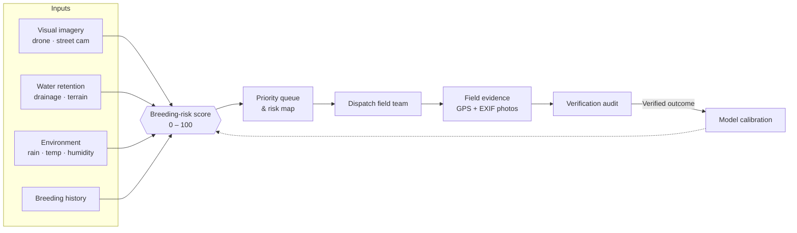

<div align="center">


# VectorGuard AI

**Predictive vector control for municipal health teams.**<br/>
Find mosquito-breeding hotspots before outbreaks start, dispatch field teams, and verify the fix with geotagged evidence.

<p>
  
  
  
  
  
  
</p>

[Overview](#overview) ·
[Features](#features) ·
[How it works](#how-it-works) ·
[Getting started](#getting-started) ·
[Project structure](#project-structure) ·
[Design system](#design-system)

</div>

> [!NOTE]
> VectorGuard AI is a **decision-support tool**. Risk scores rank places to inspect; they do not diagnose disease or detect mosquitoes. All bundled data is **demo / pilot data and is illustrative**.

---

## Overview

Vector-borne diseases such as dengue, malaria and chikungunya start where water stands still: blocked drains, construction pits, discarded tyres, flooded basements. Most municipal programs react after cases appear. VectorGuard AI moves that work earlier.

It combines imagery, weather, terrain and breeding history into one **breeding-risk score** per site, ranks the sites, and then runs the whole response loop in one place, from dispatching a field team to auditing photo evidence of the fix.

<table>
  <tr>
    <td align="center" width="25%"><h3>01 · Predict</h3>Score and rank every surveillance site by breeding risk.</td>
    <td align="center" width="25%"><h3>02 · Verify</h3>Confirm risk with targeted imagery and computer-vision cues.</td>
    <td align="center" width="25%"><h3>03 · Prevent</h3>Dispatch field teams with a recommended intervention.</td>
    <td align="center" width="25%"><h3>04 · Learn</h3>Feed verified outcomes back to calibrate the model.</td>
  </tr>
</table>

## Features

| Area | What you get |
| --- | --- |
| **Control room dashboard** | Live counts by severity, a priority action queue ranked by score, and pilot telemetry at a glance. |
| **GIS risk map** | Leaflet map of India with color-coded teardrop pins, India / state / city views, satellite, terrain, topo and dark basemaps, and a detail panel per hotspot. |
| **Hotspot directory** | Searchable, filterable list of every surveillance site with its score breakdown and an interactive formula simulator. |
| **Task dispatch** | Assign officers and teams, set deadlines, pick the recommended action, and track each task from *assigned* to *resolved*. |
| **Verification center** | Before/after photo evidence with embedded EXIF GPS metadata, a footprint map, and audit decisions. |
| **Field officer app** | Mobile-first view for assigned tasks, a GPS-aware inspection camera, and intervention history. |
| **Citizen portal** | Residents register and submit geotagged evidence of standing water, then track its status. |
| **Analytics & learning** | Risk distribution, per-city severity breakdowns, response-time KPIs, and the model-calibration loop. |
| **Reports** | One-click PDF verification reports generated in the browser. |
| **Responsible AI** | A dedicated page covering privacy, data use and the limits of the model. |

### Built for real use

- **Three roles, three experiences.** Admins get the full control room, field officers get their task queue, and citizens are confined to the evidence portal.
- **Light and dark themes.** The theme follows your system preference, persists across visits, and switches with a circular reveal from the toggle.
- **Keyboard friendly.** <kbd>Ctrl</kbd> / <kbd>⌘</kbd> + <kbd>K</kbd> opens global search, <kbd>Esc</kbd> closes dialogs, and a skip link jumps straight to content.
- **Deep links.** The URL hash tracks the active view, so Back works and views can be shared.
- **Respects reduced motion.** Movement is dropped and fades are kept when the OS asks for less motion.
- **Installable.** Ships a web manifest and maskable icons, so it can be installed as a PWA.

## How it works



### The risk score

Every site gets a transparent, explainable score:

```text
Score = (V × 0.40) + (R × 0.25) + (E × 0.20) + (H × 0.15)
```

| Factor | Weight | Signal |
| :---: | :---: | --- |
| **V** · Visual | 40% | Standing water, debris and containers seen in imagery |
| **R** · Retention | 25% | How long water is likely to stay (drainage, depressions) |
| **E** · Environment | 20% | Recent rainfall, temperature and humidity |
| **H** · History | 15% | Past breeding records at or near the site |

The score maps to one severity scale that is used everywhere: map pins, tables, charts and reports.

| Level | Range | Response |
| --- | :---: | --- |
| 🔴 **Critical** | 81 – 100 | Immediate intervention |
| 🟠 **High** | 61 – 80 | Priority dispatch |
| 🟡 **Moderate** | 31 – 60 | Scheduled inspection |
| 🟢 **Low** | 0 – 30 | Routine monitoring |

## Tech stack

| Layer | Tools |
| --- | --- |
| UI | React 19, TypeScript, Tailwind CSS 4, Lucide icons |
| Maps | Leaflet with switchable basemap tile layers |
| Data | Firebase (Firestore, Auth) with a local seed dataset as fallback |
| Weather | Open-Meteo forecast API (no key required), with an offline fallback |
| Reports | jsPDF + html2canvas |
| Build | Vite 6, with views code-split and vendor chunks cached long-term |
| Serving | A small zero-dependency Node static server (`server.js`) |

## Getting started

### Prerequisites

- [Node.js](https://nodejs.org/) **20 or newer**
- npm (bundled with Node) or [Bun](https://bun.sh/)

### Run locally

```bash
git clone https://github.com/Valavoju/Vector_Gaurd.git
```

```bash
cd Vector_Gaurd
```

```bash
npm install
```

```bash
npm run dev
```

Then open **http://localhost:3000**. The splash screen shows briefly, then the control room dashboard loads.

> [!TIP]
> Use the **role switcher** in the profile menu (top right) to see the app as a **field officer** or a **citizen**. Turn on **Demo** in the header for a guided walkthrough of the full Predict → Verify → Prevent → Learn loop.

### Build for production

```bash
npm run build
```

```bash
npm start
```

`npm start` serves the `dist/` folder on port `3000`, or on `$PORT` if it is set.

### Scripts

| Command | What it does |
| --- | --- |
| `npm run dev` | Start the Vite dev server on port 3000 with hot reload |
| `npm run build` | Production build into `dist/` |
| `npm start` | Serve the production build with `server.js` |
| `npm run lint` | Type-check the project with `tsc --noEmit` |
| `npm run clean` | Remove the `dist/` folder |

### Configuration

| Variable | Default | Purpose |
| --- | --- | --- |
| `PORT` | `3000` | Port for `npm start` and `vite preview` |
| `DISABLE_HMR` | unset | Set to `true` to turn off hot reload and file watching |

Firebase settings live in `firebase-applet-config.json`, and Firestore security rules in `firestore.rules`. To load the demo dataset into your own Firestore project, run the idempotent seed script:

```bash
npx tsx scripts/seedFirestore.ts
```

## Project structure

```text
Vector_Gaurd/
├── index.html                 # App shell, inline splash loader, pre-paint theme script
├── server.js                  # Production static server
├── firestore.rules            # Firestore security rules
├── public/                    # Favicons, PWA icons and web manifest
├── scripts/
│   └── seedFirestore.ts       # Seeds demo data into Firestore
└── src/
    ├── App.tsx                # Layout, role-based routing, lazy-loaded views
    ├── index.css              # Design tokens, glass system, motion
    ├── components/
    │   ├── dashboard/         # Control room overview
    │   ├── map/               # GIS risk map
    │   ├── hotspot/           # Directory + detail modal
    │   ├── tasks/             # Dispatch modal + task directory
    │   ├── verification/      # Evidence audit & EXIF footprint map
    │   ├── field/             # Field officer mobile app
    │   ├── citizen/           # Citizen registration & evidence portal
    │   ├── analytics/         # KPIs and charts
    │   ├── learning/          # Model calibration loop
    │   └── common/            # Header, sidebar, theme toggle, toasts, loaders
    ├── context/               # App state and theme providers
    ├── services/              # Firebase, persistence, evidence storage, weather
    ├── data/                  # Seed hotspots and India geo data
    └── utils/                 # Risk styles, EXIF/geo engine, PDF generator
```

## Design system

The interface uses a **glass** look built on the Vector Guard brand: a royal-blue to cyan gradient, frosted translucent panels, and a V-shield mark that doubles as the "V" of the wordmark.

- **Tokens first.** Colors, severity steps, easing curves and durations are CSS variables in `src/index.css`, so light and dark themes come from one source.
- **One severity scale.** `src/utils/riskStyles.ts` defines the Critical / High / Moderate / Low colors once, and every view uses them. Severity always carries a text label, not color alone.
- **Motion with purpose.** Strong ease-out curves, durations under 300 ms for interface motion, transform- and opacity-only animation, and no animation on keyboard-driven actions.

## Roadmap

- [ ] Live satellite and drone imagery ingestion
- [ ] Server-side model scoring with calibration history
- [ ] SMS / WhatsApp alerts for field teams
- [ ] Offline-first field app with background sync
- [ ] Ward-level public dashboards

## Contributing

Contributions are welcome. Open an issue to discuss a change, then send a pull request from a feature branch. Before you push, please run:

```bash
npm run lint
```

```bash
npm run build
```

---

<div align="center">

Built to support **UN SDG 3** (good health), **SDG 11** (sustainable cities) and **SDG 13** (climate action).

<sub>Demo / pilot data is illustrative. Not a medical device and not a substitute for entomological surveillance.</sub>

</div>
